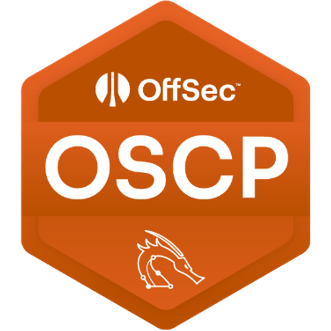
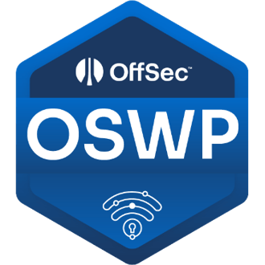
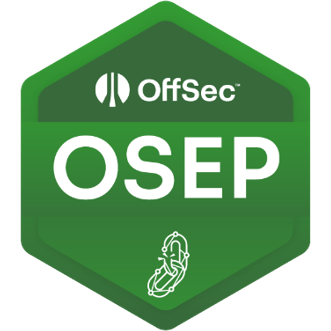

<h1 align="center">Hi, I'm Alejandro 👋</h1>

  Offensive Security Engineer

  
  
  

---

### 🔭 whoami

IT enthusiast specializing in **Offensive Security**, with a strong background in system administration, networking, incident response, and blue teaming.

For the past 3+ years, I have been conducting penetration testing, ethical hacking, and Red Team engagements in enterprise environments. My hands-on experience spans **Web/API, Wi-Fi, Active Directory, External/Perimeter, Infrastructure, Mobile (iOS/Android), and Cloud (Azure / Entra ID)**.
 
 Sometimes I write about offensive security on my blog, **[CAIN](https://blog.cain.tech)**

### 🏅 Certifications

  &nbsp;
  &nbsp;
  &nbsp;
  &nbsp;
  

Click any badge to verify the credential.

### 📌 Featured work

Pinned repositories below, proof-of-concepts and tooling
